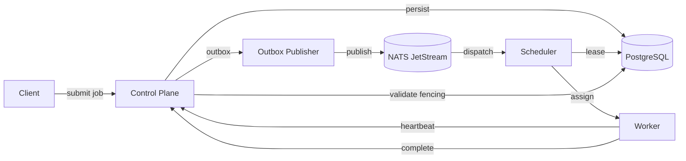
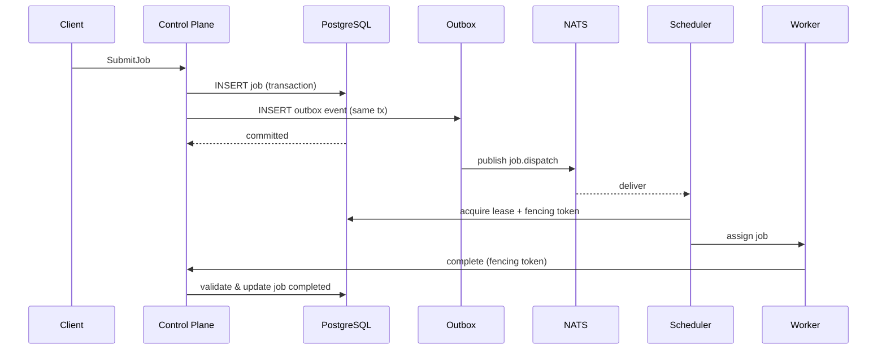
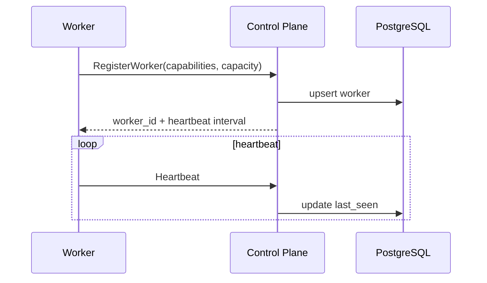
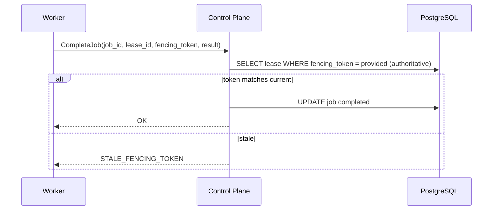
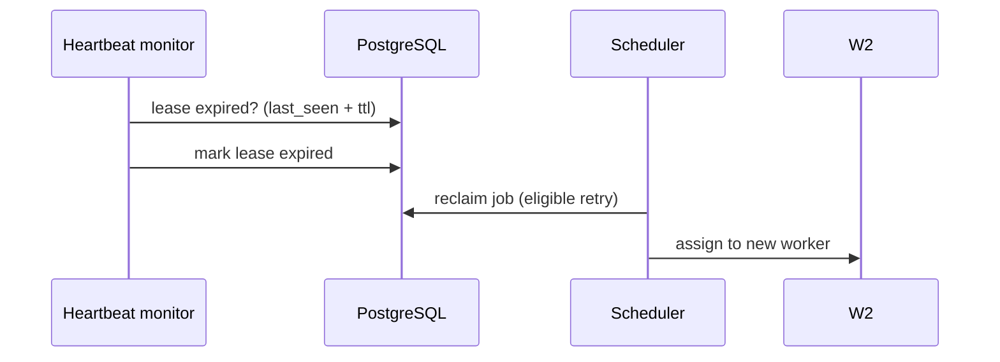

# Obscura Next v0.3.0 — Distributed Control Plane Architecture

## 1. Overview

v0.3.0 adds a distributed control plane on top of the v0.2.0 supervised worker engine.
The browser engine and worker supervision remain unchanged. New components: control plane service,
PostgreSQL authoritative state, NATS JetStream messaging, distributed scheduler, worker registry,
lease/fencing system.

## 2. Component boundaries

- Control Plane: API, auth, validation, scheduling decisions, persistence orchestration.
- Worker Engine (existing): browser execution in supervised processes.
- PostgreSQL: authoritative state.
- NATS JetStream: durable async messaging.
- Worker Registry: worker identity, health, capacity.
- Lease Manager: ownership and fencing tokens.
- Outbox: transactional message publication.

The control plane does not execute browsers. Workers do not own authoritative job state.

## 3. Architecture diagram



## 4. Data flow: job submission



## 5. Worker registration



## 6. Lease acquisition

```mermaid
sequenceDiagram
  participant S as Scheduler
  participant PG as PostgreSQL
  participant W as Worker
  S->>PG: BEGIN; SELECT job FOR UPDATE SKIP LOCKED
  S->>PG: INSERT lease, fencing_token = seq+1
  S->>PG: COMMIT
  S->>W: Execute(job, lease_id, fencing_token)
```

## 7. Job completion



## 8. Worker crash recovery



## 9. Duplicate message

NATS redelivery: scheduler/consumer checks job_attempts/idempotency key in PostgreSQL. If already processed, ack and skip.

## 10. Broker outage

Jobs remain in PostgreSQL + outbox pending. Publisher retries. On recovery, dispatch resumes. No durable success claimed while NATS down for dispatch-critical path; outbox absorbs.

## 11. Stale worker

Worker A loses lease; Worker B gets higher fencing token. Worker A's completion rejected at persistence boundary by fencing token comparison.

## 12. Constraints reused from v0.2.0
- V8 LocalSet single-thread runtime.
- SSRF protections.
- Worker protocol v1.0.
- Process supervision.

No rewrite of browser engine.
